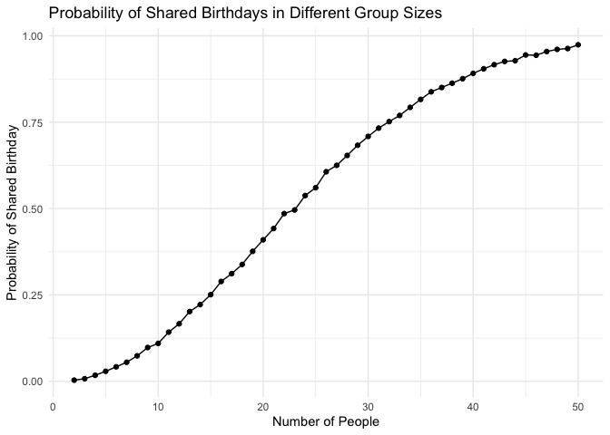

p8105_hw5_eej2124
================
Emma
2026-11-10

``` r
library(tidyverse)
```

# Problem 1

## Write a function to assess birthday overlap in a room of `n` people.

``` r
source("source/birthday_overlap.R")
```

## Run the function 10,000 times for group sizes of 2 - 50 people.

``` r
birthday_results_df = 
  expand_grid(
    number_of_people = 2:50, 
    iter = 1:10000 
  ) |> 
  mutate(
    repeated = map_lgl(number_of_people, birthday_overlap)
  )
```

## Plot showing the probability of birthday overlap as a function of group size

``` r
birthday_results_df |> 
  group_by(number_of_people) |> 
  summarize(prob_of_repeat = mean(repeated)) |> 
  ggplot(aes(x = number_of_people, y = prob_of_repeat)) +
  geom_point() +
  geom_line()  +
  labs(
    title = "Probability of Shared Birthdays in Different Group Sizes", 
    x = "Number of People", 
    y = "Probability of Shared Birthday") +
  theme_minimal()
```

<!-- -->

In a room of 23 people, there is a ~50% chance that two people will
share a birthday. This probability increases steadily as the number of
people in the room increases.

# Problem 2
