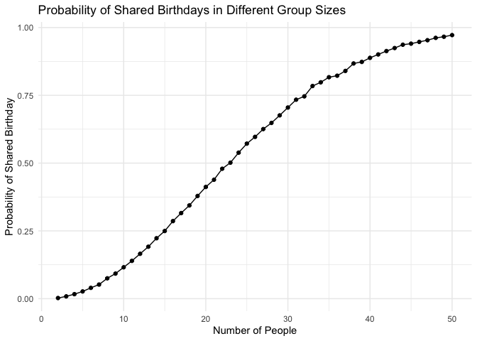
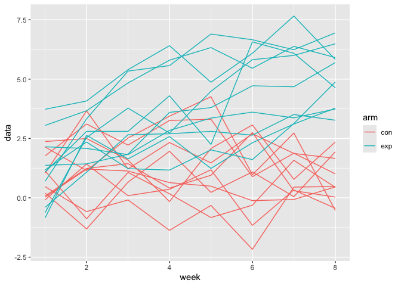
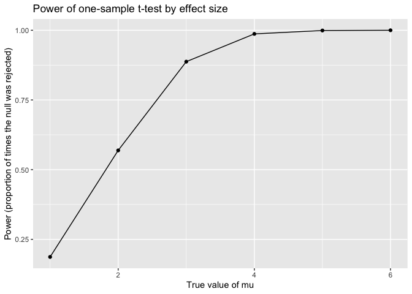

p8105_hw5_eej2124
================
Emma
2026-11-10

``` r
library(tidyverse)
```

``` r
set.seed(1)
```

# Problem 1

## Write a function to assess birthday overlap in a room of `n` people.

``` r
source("source/birthday_overlap.R")
```

## Run the function 10,000 times for group sizes of 2 - 50 people.

``` r
birthday_results_df = 
  expand_grid(
    number_of_people = 2:50, 
    iter = 1:10000 
  ) |> 
  mutate(
    repeated = map_lgl(number_of_people, birthday_overlap)
  )
```

## Plot showing the probability of birthday overlap as a function of group size

``` r
birthday_results_df |> 
  group_by(number_of_people) |> 
  summarize(prob_of_repeat = mean(repeated)) |> 
  ggplot(aes(x = number_of_people, y = prob_of_repeat)) +
  geom_point() +
  geom_line()  +
  labs(
    title = "Probability of Shared Birthdays in Different Group Sizes", 
    x = "Number of People", 
    y = "Probability of Shared Birthday") +
  theme_minimal()
```

<!-- -->

In a room of 23 people, there is a ~50% chance that two people will
share a birthday. This probability increases steadily as the number of
people in the room increases.

# Problem 2

## Make a dataframe with all file names

``` r
participants_df = 
  tibble(
    file_name = list.files(path = "data", full.names = TRUE)
    ) 
```

## Iterate over file names and read in data for each participant

``` r
data_import = function(file) {
  
  data_df = 
    read_csv(file = file) |> 
    janitor::clean_names() |> 
    pivot_longer(
      week_1:week_8,
      names_to = "week", 
      values_to = "data"
      ) |> 
    mutate(
      week = str_replace(week, "week_", ""), 
      week = as.numeric(week))
  
  return(data_df)
  }
```

``` r
participants_df =
  participants_df |> 
  mutate(
    data = map(file_name, data_import)) |> 
  unnest() 
```

    ## Warning: `cols` is now required when using `unnest()`.
    ## ℹ Please use `cols = c(data)`.

## Tidy the result

``` r
participants_df =
  participants_df |> 
   mutate(
     file_name = str_replace(file_name, ".csv", ""), 
     file_name = str_replace(file_name, "data/", ""), 
     subject_id = file_name
   ) |> 
  separate(file_name, into = c("arm", "id"), sep = "_")
```

## Make a spaghetti plot showing observations of each subject over time

``` r
participants_df |> 
  ggplot(aes(x = week, y = data, group = subject_id, color = arm)) +
  geom_line()
```

<!-- -->

The observations of participants in the experimental arm of the study
have higher data points than the control arm. Additionally, there seems
to be a slight increasing trend in the experimental group over the 8
weeks of observation.

# Problem 3

## Exploring power using a function

``` r
t_test_power = function(n = 30, mu = 0, sigma = 5) {
  
  x = rnorm(n = n, mean = mu, sd = sigma)
  
  t.test(x, mu = 0) |> 
    broom::tidy() |> 
    select(estimate, p.value)
  
}
```

## Generate 5000 datasets

``` r
t_test_results_df =  
  expand_grid(
    mu = 0,
    iter = 1:5000
  ) |> 
  mutate(
    results = map(mu, \(m) t_test_power(n = 30, mu = m, sigma = 5))
  ) |> 
  unnest(results)
```

## Repeating when mu = 1:6

``` r
t_test_results_df =  
  expand_grid(
    mu = 1:6,
    iter = 1:5000
  ) |> 
  mutate(
    results = map(mu, \(m) t_test_power(n = 30, mu = m, sigma = 5))
  ) |> 
  unnest(results)
```

## True value of mu vs. power of the test plot

``` r
t_test_results_df |> 
  group_by(mu) |> 
  summarize(
    power = mean(p.value < 0.05)
  ) |> 
  ggplot(aes(x = mu, y = power)) + 
  geom_point() +
  geom_line() +
  labs(
    x = "True value of mu",
    y = "Power (proportion of times the null was rejected)",
    title = "Power of one-sample t-test by effect size"
  )
```

<!-- -->

As the effect size increases, along with the true value of mu, the
proportion of times the null was rejected, or the power, also increases.
Once the true value of mu = 4, the null was rejected almost 100% of the
time.

## True value of mu vs. average estimates of mu plots

``` r
avg_mu_estimates_df = 
  t_test_results_df |> 
  group_by(mu) |> 
  summarize( 
    all_avg_estimates = mean(estimate), 
    rejected_avg_estimates = mean(estimate[p.value < 0.05])
    ) |> 
  pivot_longer(
    all_avg_estimates:rejected_avg_estimates, 
    names_to = "sample", 
    values_to = "average estimate"
  )
```
